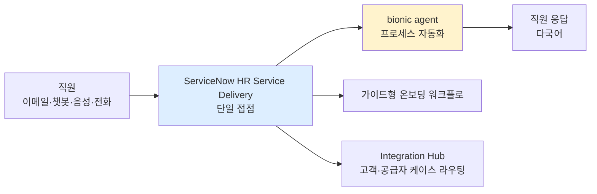

## Summary

Siemens GBS(Global Business Services)가 HR·재무 공유서비스를 ServiceNow HR Service Delivery·App Engine·Integration Hub 위에 통합 (⚠️ 벤더 사례, ServiceNow 고객 스토리 PDF 2023-02). ⚠️ 벤더 사례: Siemens 직원 311,000명(2022-09-30 기준), 180개국 이상, GBS 11개 주요 delivery location. 이메일·챗봇·음성·전화를 포함하는 디지털 상호작용 계층, "bionic agent" 프로세스 자동화, 가이드형 온보딩 워크플로. ⚠️ 자사 보고(GBS CIO Matthias Egelhaaf, 벤더 PDF 게재): 사용자 만족도 8.8/10, 직원 87% 가 업무를 즐긴다고 응답, 자동화 누적 1M 시간(one million automated hours, multiple technologies 기준). [[sources/servicenow-siemens-case-study.md]] 종전 "360,000명 지원·월 110,000 방문·100개 이상 메일박스·My Services 포털·AI 에이전트 인테이크" 서술은 2026-10-19 확보한 원문에 없어 _미공개_ (Contradictions 참조)

## Problem / Why (도입 배경)

- **Before (baseline)**: ⚠️ 벤더 사례: 180개국 이상에서 국가별 규제 대응을 위해 특히 HR에 다수 시스템 운영, 복수 이해관계자를 단일 환경·공통 경험으로 연결하는 것이 오랜 과제 (Sree Ravuri, Head of GBS Hire-to-Retire). [[sources/servicenow-siemens-case-study.md]] 정량 baseline ❓ 미공개
- **Pain point**: ⚠️ 벤더 사례: 연간 송장 10 million건, 급여명세서 six million건, 주문 700,000건의 고볼륨 프로세스에 기술 투입 기회 (CIO Egelhaaf). 유연성이 핵심 요구사항, HR 기술 환경 전체를 클라우드 기반으로 재구성. [[sources/servicenow-siemens-case-study.md]]
- **Trigger**: ⚠️ 벤더 사례: GBS의 workforce-led → technology-led 전환 전략. Siemens 중앙 IT가 이미 ServiceNow를 사용 중이어서 HR Service Delivery 확장 결정. [[sources/servicenow-siemens-case-study.md]] 종전 "수백 개 이메일 사서함 분산·레거시 병존" 서술은 원문에 없어 삭제

## Solution Architecture

> **최우선 원칙**: 이 섹션은 **공개된 사실만** 기록한다.

### A. Process (프로세스)

- **Before (As-is)**: ⚠️ 벤더 사례: 국가별 규제 대응용 다수 HR 시스템, 이해관계자별 분산 환경 (단일 환경·공통 경험 부재). [[sources/servicenow-siemens-case-study.md]] 종전 "100개 이상 이메일 사서함 분산"은 원문에 없음
- **After (To-be)** (⚠️ 벤더 사례 [[sources/servicenow-siemens-case-study.md]]):
  1. 백본 시스템·incident/change 관리 등 공유서비스센터의 서비스 관리 프로세스를 ServiceNow HR Service Delivery로 이전, 직원 대상 단일 접점(single point of contact) 제공
  2. 이메일·챗봇·음성·전화를 포함하는 디지털 상호작용 계층 구축
  3. "bionic agent" 프로세스 자동화로 응답 시간 단축·오류 감소·다국어 제공
  4. 가이드형 온보딩 워크플로 (입사 전 관계 형성, 첫날 업무 준비 완료)
  5. Integration Hub로 고객·공급자에게 케이스 라우팅, 클라우드 전화를 Amazon 또는 Microsoft Teams에 연결
  - 종전 "ServiceNow AI 에이전트가 인테이크·라우팅·해결 자동화" 서술은 원문에 없어 삭제
- **Human-in-the-loop (HITL) 지점**: _미공개 (not disclosed)_. 종전 "복잡 케이스 담당자 라우팅"은 원문에 없음
- **Trigger & Frequency**: 직원 문의 발생 시 수시(on-demand). ⚠️ 벤더 사례 (PDF 표지 타일, 세 수치 중 1M 시간·87%가 본문에서 확인되므로 15K는 월 자동 해결 티켓 수에 해당): 월 15K 티켓 자동 해결. [[sources/servicenow-siemens-case-study.md]] 종전 "월 110,000건"은 원문에 없음
- **Scope of autonomy**: ⚠️ 벤더 사례: bionic agent 자동화. 자율 범위 세부 _미공개_

범례: 실선 = [[sources/servicenow-siemens-case-study.md]] 확인 (⚠️ 벤더 사례). 자동 해결과 담당자 처리의 분기 지점은 원문에 없어 미표시.

### B. System & Infrastructure (시스템·인프라)

- **Core HRIS / 기반 시스템**: _미공개 (not disclosed)_
- **AI 시스템 배치**: ⚠️ 벤더 사례: ServiceNow HR Service Delivery + App Engine + Integration Hub, "bionic agent" 프로세스 자동화. [[sources/servicenow-siemens-case-study.md]] 종전 "ServiceNow AI Platform" 명칭은 원문에 없음
- **배포 환경**: ⚠️ 벤더 사례: 클라우드 기반 기술로 전환 (HR 기술 환경 재구성). [[sources/servicenow-siemens-case-study.md]] 세부 _미공개_
- **연동·통합**: ⚠️ 벤더 사례: Integration Hub로 고객·공급자 케이스 라우팅, 기술 공급자·디지털 서비스 생태계 연결, 클라우드 전화를 Amazon 또는 Microsoft Teams에 연결. [[sources/servicenow-siemens-case-study.md]] 종전 "레거시 시스템 다수 퇴역"은 원문에 없음
- **사용자 접점 (UX layer)**: ⚠️ 벤더 사례: 이메일, 챗봇, 음성, 전화. [[sources/servicenow-siemens-case-study.md]]
- **인증·권한**: _미공개 (not disclosed)_

### C. Data (데이터)

- **입력 데이터 소스**: _미공개 (not disclosed)_. 원문은 서비스·센터 이전 시 프로세스·데이터 모델 조화와 데이터 중앙화만 언급 (Philip Hechtl, Head of AI and Digital Service Management). [[sources/servicenow-siemens-case-study.md]]
- **데이터 규모**: ⚠️ 벤더 사례: Siemens 직원 311,000명(2022-09-30 기준), GBS 연간 처리량 송장 10 million건·급여명세서 six million건·주문 700,000건. [[sources/servicenow-siemens-case-study.md]] 월 포털 방문 수·메일박스 수는 원문에 없어 _미공개_
- **전처리·정제**: _미공개 (not disclosed)_
- **학습 vs RAG vs In-context**: _미공개 (not disclosed)_
- **데이터 거버넌스**: _미공개 (not disclosed)_

### D. Model (모델)

- **Foundation model**: _미공개 (not disclosed)_. 원문(2023-02)에 Now Assist·LLM 언급 없음, "bionic agent" 자동화의 기술 세부 _미공개_
- **커스터마이징 기법**: _미공개 (not disclosed)_

### E. Organization & Team (조직·팀 구조)

- **오너십**: ⚠️ 벤더 사례: Siemens GBS(Global Business Services, 약 20년 전 설립, HR·재무에서 출발해 11개 주요 delivery location의 다기능 조직으로 확장)가 운영 주체. Hire-to-Retire 프로그램이 온보딩·급여·복리후생·직원 데이터·글로벌 모빌리티 담당. [[sources/servicenow-siemens-case-study.md]]
- **참여 역할**: ⚠️ 벤더 사례: CIO/Chief Digitalization Officer Matthias Egelhaaf, Head of AI and Digital Service Management Philip Hechtl, Head of GBS Hire-to-Retire Sree Ravuri, Head of Digital Lab Sonia Chopra-Sohanpall. [[sources/servicenow-siemens-case-study.md]]
- **전략 방향**: ⚠️ 벤더 사례: "워크포스 주도 조직에서 기술 주도 조직으로" 전환이 GBS의 장기 전략. [[sources/servicenow-siemens-case-study.md]]
- **팀 규모**: _미공개 (not disclosed)_
- **파트너**: ⚠️ 벤더 사례: ServiceNow ("partner and guiding us on what to do next", Philip Hechtl). [[sources/servicenow-siemens-case-study.md]]

## Impact / Metrics (기대효과)

### 기대효과 요약
⚠️ 자사 보고(GBS CIO 인용, 벤더 PDF 게재): 사용자 만족도 8.8/10, 직원 87% 업무 만족, 자동화 누적 1M 시간, 2022년 상당한 비용 절감(금액 _미공개_). 종전 "월 110,000건 방문·100개 이상 메일박스·레거시 폐기"는 원문에 없어 _미공개_.

- ⚠️ **자사 보고**: 사용자 만족도 8.8/10. [[sources/servicenow-siemens-case-study.md]]
- ⚠️ **자사 보고**: 직원의 87% 가 업무를 즐긴다고 응답. [[sources/servicenow-siemens-case-study.md]]
- ⚠️ **자사 보고**: 자동화 누적 1M 시간 ("multiple technologies" 기준, ServiceNow 단독 효과 아님). [[sources/servicenow-siemens-case-study.md]]
- ⚠️ **벤더 사례** (PDF 표지 타일): 월 15K 티켓 자동 해결. [[sources/servicenow-siemens-case-study.md]]
- ⚠️ **벤더 사례**: ServiceNow 솔루션이 2022년 "significant savings"에 기여, 금액 _미공개_. [[sources/servicenow-siemens-case-study.md]]
- 월 포털 방문 수·통합 메일박스 수: _미공개_ (원문에 없음, 2026-10-19 확인)

## Governance & Risk

- 독일 노사관계(Betriebsrat) 환경에서의 AI 도입 — 종업원 협의회와의 협의 과정 _미공개 (not disclosed)_.
- GDPR 적용 환경. 세부 데이터 처리 동의 방식 _미공개 (not disclosed)_.

## Contradictions

> [!note] 2026-10-19 grounding — 2026-09-27 점검에서 미태깅이었던 본 페이지의 ✅ Fact 수치·명칭(360,000명 지원·월 110,000 방문·100개 이상 메일박스·My Services 포털·ServiceNow AI Platform·AI 에이전트 인테이크·라우팅·레거시 퇴역·복잡 케이스 담당자 라우팅)은 2026-10-19 확보한 ServiceNow PDF 원문(2023-02)에 없음. 소스 페이지의 검색 스니펫(HTML 고객 스토리 페이지 유래) 기반이었으므로 모두 _미공개_로 교체하고, 원문 확인 항목(311,000명·180개국·11개 delivery location·8.8/10·87%·1M 자동화 시간·15K 월 자동 해결 티켓·HRSD/App Engine/Integration Hub·bionic agent·온보딩 워크플로·Teams/Amazon 전화 연동)으로 복구. 벤더 PDF이므로 ✅ Fact → ⚠️ 벤더 사례/자사 보고로 재표기. frontmatter `output`(360K·월 110,000건·AI 에이전트)도 동일 문제, 별도 정정 필요. HTML 고객 스토리(servicenow.com/customers/siemens-ag.html)는 별도 source 확보 후 수치 재검토.

## Consulting Angle

- **유럽 제조업 대기업 레퍼런스**: Siemens GBS 사례는 공유서비스센터(SSC) 모델로 HR·재무·구매를 통합 운영하는 대기업의 AI 전환 패턴. 국내 대기업 GBS/SSC 도입 제안 시 즉시 활용.
- **"다국가 다수 HR 시스템 → 단일 접점" 스토리**: 복잡성 가시화와 통합의 ROI를 설명하는 설득 프레임. 종전 "100개 이메일 사서함 → 1개 포털" 수치는 원문 미확인이므로 외부 인용 금지.
- **ServiceNow HR 도입 타당성**: ServiceNow Now Assist HRSD와 결합했을 때의 실제 운영 결과 사례로 활용 (→ [[servicenow-now-assist-hr]] 연계).
- **파생 질문**: "독일 Betriebsrat(종업원 협의회) 제도가 있는 환경에서 AI 도입 시 노사 협의 방법론은? 한국의 노사협의회와 비교 가능한가?"
