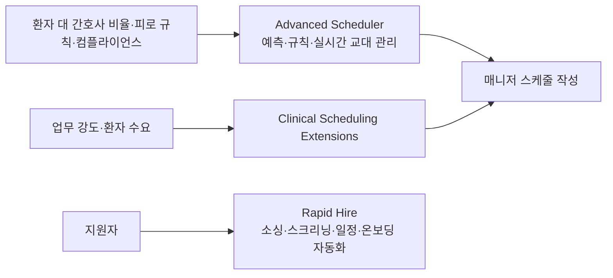

## Summary

⚠️ 벤더 주장 (UKG 보도자료 2026-02-17, [[sources/ukg-healthcare-scheduling-2026-02.md]], 2026-10-19 원문 확보): 미국 최대 헬스케어 시스템의 **90% 가까이**(Nearly 90%)가 UKG 사용. UKG Pro HCM·UKG Pro Workforce Management 스위트에 헬스케어 특화 솔루션(Rapid Hire, Advanced Scheduler, Clinical Scheduling Extensions, EZCall for Physicians, Talk, Wallet) 추가. Advanced Scheduler는 예측 도구·규칙 기반 스케줄링·실시간 교대 관리를 결합해 환자 대 간호사 비율·피로 규칙·컴플라이언스를 반영한 스케줄 작성을 지원. [[sources/ukg-healthcare-scheduling-2026-02.md]] 종전 **KC CARE Health Center**(리텐션 92%·효율성 60%), **Jetro Restaurant Depot**($1.8M·$2.2M 절감), **Workforce Intelligence Hub**, One View 수치는 2026-10-19 확보한 원문에 없어 _미공개_ (Contradictions 참조).

## Problem / Why (도입 배경)

- 프론트라인(의료·소매·외식) 인력의 **교대 스케줄링 복잡성** — 자격증·컴플라이언스·선호도·공정근무법 등 다중 제약
- 높은 이직률 → **채용·온보딩 비용 반복 발생**
- 스케줄·타임·급여 데이터가 **사일로화** → 실시간 의사결정 불가
- 프론트라인 직원의 **번아웃** — 비효율 스케줄링이 주 원인 중 하나

## Solution Architecture

### A. Process (프로세스)

- **Before**: ❓ baseline 미공개. 원문은 번아웃·인력 부족 산업 특성만 서술 (UKG 자체 조사: 급성기 83%·비급성기 82% 의료 종사자가 번아웃 경험) [[sources/ukg-healthcare-scheduling-2026-02.md]]
- **After** (⚠️ 벤더 주장 [[sources/ukg-healthcare-scheduling-2026-02.md]]): Advanced Scheduler가 예측 도구·규칙 기반 스케줄링·실시간 교대 관리를 결합해 환자 대 간호사 비율·피로 규칙·컴플라이언스 제약 하에 매니저의 스케줄 작성 지원 → Clinical Scheduling Extensions가 업무 강도 정량화·환자 수요 예측·실시간 인력 수준 조정 → EZCall이 의사 선호·요청·FTE·휴가 반영 → Rapid Hire가 소싱·스크리닝·일정·온보딩 등 반복 채용 업무 자동화. 종전 "Workforce Intelligence Hub 통합 뷰"는 이 원문에 없어 삭제
- **HITL 지점**: ⚠️ 벤더 주장: 매니저가 스케줄 작성 주체 (Advanced Scheduler "enables managers to build schedules") [[sources/ukg-healthcare-scheduling-2026-02.md]]. 승인 절차 세부 _미공개_
- **Trigger & Frequency**: 교대 스케줄링(일간)·채용(수시). 원문에 주기 명시 없음
- **Scope of autonomy**: ⚠️ 벤더 주장: "agentic agents to handle monotonous tasks" [[sources/ukg-healthcare-scheduling-2026-02.md]]. 자율 범위 세부 _미공개_

범례: 실선 = [[sources/ukg-healthcare-scheduling-2026-02.md]] 확인 (⚠️ 벤더 주장). 매니저 승인·반려 분기는 원문에 없어 미표시.

### B. System & Infrastructure (시스템·인프라)

- **Core 플랫폼**: ⚠️ 벤더 주장: UKG Pro HCM·UKG Pro Workforce Management 스위트 (UKG Workforce Operating Platform) [[sources/ukg-healthcare-scheduling-2026-02.md]] (2026-10-19 원문 확인으로 복구)
- **AI 시스템**: _미공개 (not disclosed)_. 종전 "Bryte AI·Great Place To Work Hub 연동"은 이 원문에 없음 (Bryte AI는 별도 source ukg-workforce-intelligence-hub-2025 raw에 있으나 본 페이지 sources 미포함)
- **Workforce Intelligence Hub**: _미공개 (not disclosed)_. 이 원문에 없음 (별도 source ukg-workforce-intelligence-hub-2025 raw에 2025-11 발표·2026 상반기 가용 예정으로 있음, sources 추가 필요)
- **데이터 규모**: _미공개 (not disclosed)_. 종전 "12B+ 스케줄·10B 출퇴근·750M+ 지원자"는 원문에 없음. ⚠️ 벤더 주장: 3,500개 이상 병원·10,000개 post-acute 시설 고객 [[sources/ukg-healthcare-scheduling-2026-02.md]]

### C. Data (데이터)

- **입력**: ⚠️ 벤더 주장: 환자 대 간호사 비율·피로 규칙·컴플라이언스 규칙(Advanced Scheduler), 업무 강도·환자 수요(Clinical Scheduling Extensions), 의사 선호·요청·FTE·휴가(EZCall) [[sources/ukg-healthcare-scheduling-2026-02.md]]. 종전 "Great Place To Work 설문"은 원문에 없음
- **One View**: _미공개 (not disclosed)_. $14.6B·>99%·84% 수치는 원문에 없음. ⚠️ 벤더 주장: 150개국·80,000개 이상 조직 운영 [[sources/ukg-healthcare-scheduling-2026-02.md]]
- 학습/RAG 방식: _미공개 (not disclosed)_

### D. Model (모델)

- _미공개 (not disclosed)_

### E. Organization & Team (조직·팀 구조)

- _미공개 (not disclosed)_

## Impact / Metrics (기대효과)

### 기대효과 요약

프론트라인 인력 스케줄링 지원 + 반복 채용 업무 자동화. 고객별 outcome 수치는 인용 소스 원문에 없어 _미공개_ (종전 KC CARE·Jetro·One View 수치는 2026-10-19 원문 확인 결과 부재).

| 지표 | 값 | 기업 | 출처 | 성격 |
|---|---|---|---|---|
| 리텐션 개선 | _미공개_ (종전 92%는 원문에 없음) | KC CARE | — | ❓ |
| 효율성 향상 | _미공개_ (종전 60%는 원문에 없음) | KC CARE | — | ❓ |
| 연간 비용 절감 | _미공개_ (종전 $1.8M·$2.2M는 원문에 없음) | Jetro Restaurant Depot | — | ❓ |
| 헬스케어 시장 점유 | **Nearly 90%** 미국 최대 시스템 | 산업 전체 | [[sources/ukg-healthcare-scheduling-2026-02.md]] | ⚠️ 벤더 주장 |
| Touchless payroll | _미공개_ (종전 84%는 원문에 없음) | UKG One View | — | ❓ |
| Payroll 정확도 | _미공개_ (종전 >99%는 원문에 없음) | UKG One View | — | ❓ |
| 직원 AI 스케줄 신뢰 | _미공개_ (종전 75%는 원문에 없음) | 설문 | — | ❓ |

## Governance & Risk

- AI 스케줄링의 **공정성** — 특정 직원에게 불리한 교대 패턴 반복 위험
- 프론트라인 직원의 **AI에 대한 신뢰**: 종전 "75%가 AI가 스케줄 관리를 용이하게 한다"는 수치는 원문에 없어 _미공개_ (2026-10-19 확인); '고용주가 AI를 준비시킨다'는 인식 비율도 _미공개_. 원문 확인: UKG 자체 조사에서 급성기 83%·비급성기 82% 의료 종사자가 번아웃 경험 [[sources/ukg-healthcare-scheduling-2026-02.md]]
- 52시간제(한국) 등 지역 노동법 컴플라이언스 자동 반영 필요

## Contradictions

_없음._

> [!note] 2026-09-27 grounding — 유일한 인용 소스는 UKG 보도자료(BusinessWire)이며 raw 스냅샷 unavailable — 모든 수치는 소스 페이지 요약 기준 ⚠️ 벤더 주장/자사 보고이며 원문 미확인. Core 플랫폼(UKG Pro/Ready) 서술과 '고용주가 AI를 준비시킨다'는 인식 조사 수치는 소스에 없어 `_미공개_`.
> 2026-10-19 원문 확보 후 복구: BusinessWire 원문(Aside, 2026-02-17)으로 Core 플랫폼(UKG Pro HCM·Pro Workforce Management), Nearly 90% 시장 점유, Advanced Scheduler·Clinical Scheduling Extensions·EZCall·Rapid Hire 기능, 번아웃 조사(83%·82%) 복구. 반면 종전 소스 페이지 요약 기반 수치(KC CARE 92%·60%, Jetro $1.8M·$2.2M, One View $14.6B·>99%·84%, 12B+ 스케줄·10B 출퇴근·750M+ 지원자, 75% AI 스케줄 신뢰, Workforce Intelligence Hub, Bryte AI, GPTW 연동)는 원문에 없어 모두 _미공개_로 교체. 원문의 NHS Management 사례(time-to-hire 10일 단축·apply-to-hire 전환 3배·신규 연매출 $2.2 million)와 Rapid Hire 최대 90% 자동화는 신규 수치라 본문 미반영(source 페이지 참조). frontmatter `company: KC CARE Health Center`·`related_companies`·`output`은 원문 근거가 없어 별도 정정 필요. Workforce Intelligence Hub·Bryte AI는 [[sources/ukg-workforce-intelligence-hub-2025]] raw에 있으므로 sources 추가 후 복구 가능

## Consulting Angle

### 활용 포인트
- **프론트라인 워크포스 AI의 대표 사례**: 헬스케어·소매·외식 클라이언트에게 직접 참고
- **"Workforce Intelligence Hub" 개념**: 스케줄·타임·급여·채용 데이터 통합은 국내 대기업 HR 데이터 사일로 문제 해결의 벤치마크 (본 페이지 인용 소스에는 없음, [[sources/ukg-workforce-intelligence-hub-2025]] 참조)
- **Touchless payroll 84%**: 원문 미확인 수치이므로 외부 인용 금지 (_미공개_)

### 한국 적용
- 한국 제조·유통·병원의 교대제 스케줄링 + 52시간 컴플라이언스 → UKG 모델 참조
- 국내: 시프티(Shiftee)가 유사 포지션이나 AI 기능은 계획 단계 → UKG와 격차 비교 가능
- UKG는 글로벌 150+ 국가 운영이나 한국 시장 직접 진출 여부 _미공개_
